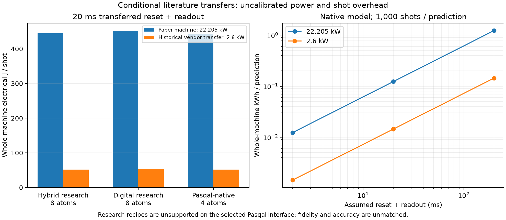

# Literature-based Rydberg energy/cost scenarios

These estimates transfer published Rydberg-hardware parameters to our compiled schedules. They are conditional scenarios, not measurements or calibration of Pasqal FRESNEL. Radiation-source and whole-machine electrical energy are different boundaries; do not add them together.

## Sources and reproducibility

- [Alves, Pezzutto and Omar, arXiv:2601.03141v2](https://arxiv.org/html/2601.03141v2), Sections IV.1–IV.2: source powers, timing and trapping/preparation/readout budget. Cesium experimental reference; excludes wall-plug conversion and classical/environmental costs.
- [Carrasco-Codina et al., arXiv:2605.15090v2](https://arxiv.org/html/2605.15090v2), Section 6.2, Eq.18 and Tables 8–9: full electrical component inventory and operation times. Harvard rubidium reference, not a Pasqal measurement.
- [Pasqal, 5 October 2023](https://www.pasqal.com/blog/quantum-computing-rethinking-energy-consumption/): historical approximately 2.6 kW vendor statement, used only as a power-transfer sensitivity scenario.

Reproducing Alves' tabulated arithmetic gives 0.662310 mJ of computation radiation per execution and 69.504757 J for 700 complete executions, matching its rounded 0.662 mJ and 69.5 J. Summing Carrasco-Codina Table 8 baseline components gives 22205 W (the paper rounds this to approximately 22 kW); continuous-reload extras are not added.

The paper's Eq.18 is also implemented exactly. Its transport term is kept explicit; its approximate prose examples do not exactly reproduce Eq.18 with beta=0.25. We do not identify a two-layer VQC with depth D=2 in that equation. Our fixed-register schedule scenario instead uses actual compiled control time, 10 ms reset + 10 ms readout transferred from Table 9, and explicitly assumes zero extra motion/reconfiguration/reloading. Those omitted overheads need calibration.

## Whole-machine electrical scenario

Assume 1000 shots per prediction. Illustrative electricity tariff: 0.25 EUR/kWh. This is not a market quote or a cloud-provider price. The full reference machine's power is allocated to the workload; it is not divided by qubit count or added to the radiation estimate.

| Implementation | Qubits | Test inputs | Mean control window | 22.205 kW reference: J/shot | kWh/prediction |
|---|---:|---:|---:|---:|---:|
| digital_analog | 8 | 400 | 18.937 us | 444.520 | 0.123478 |
| digital | 8 | 400 | 334.085 us | 451.518 | 0.125422 |
| pasqal_native_analog | 4 | 40 | 0.682 us | 444.115 | 0.123365 |

For the Pasqal-native classifier's 40 held-out inputs:

| Assumed power envelope | Mean J/shot | kWh for 40 inputs | Electricity cost for 40 inputs |
|---|---:|---:|---:|
| harvard_paper_reference | 444.115 | 4.934613 | 1.2337 EUR |
| pasqal_historical_power_transfer | 52.002 | 0.577797 | 0.1444 EUR |

These scenarios mix a specified power envelope with transferred shot overheads; they are not confidence intervals, bounds, or current Pasqal energy measurements. Preparation/readout dominate at the assumed rates, so pulse-duration ratios must not be presented as full-machine energy-saving ratios.

## Radiation-source transfer scenario

This optional counterfactual holds the paper's source on-powers fixed, charges Raman control at its derived microwave radiation power, assumes one blue reference power per illuminated atom, and counts shared IR once. Trap/preparation/readout use the paper's 49-trap reference. It is **not** a calibration from our effective Rabi rates, wavelengths, beam geometry or atomic species. Its architecture ranking can change with those assumptions. Electrical energy remains unknown at this boundary.

| Implementation | Mean source-radiation J/shot | Control-only source-radiation J/shot |
|---|---:|---:|
| digital_analog | 0.098218055 | 0.000019576 |
| digital | 0.101470120 | 0.003117218 |
| pasqal_native_analog | 0.098197308 | 0.000007774 |

## Hypothetical hardware training budget

The native SPSA recipe can be projected into circuit-feature evaluations, but it was executed on the CPU with exact expectation values. Assuming 1,000 shots per feature evaluation would change the optimization trajectory and attainable accuracy.

- harvard_paper_reference: 2500 circuit-feature evaluations, 2,500,000 hypothetical physical shots, 13.889 allocated hardware hours, 308.413 kWh. This is not the CPU simulation's energy.
- pasqal_historical_power_transfer: 2500 circuit-feature evaluations, 2,500,000 hypothetical physical shots, 13.889 allocated hardware hours, 36.112 kWh. This is not the CPU simulation's energy.

No hardware-training budget is inferred for the original exact-adjoint optimizers. Their future hardware gradient method and sampling plan are unspecified.

## Limits

The original digital/hybrid recipes cannot run as written on the selected global-only Pasqal interface. The native analog model uses a different architecture/data budget. Physical fidelities and accuracies are not matched; these tables are accounting scenarios, not an energy-advantage benchmark. Real wall power, readout/reset/loading times, failed-shot handling, idle allocation and external classical preprocessing/training/inference energy remain unmeasured. Manufacturing and embodied energy are outside scope. No cloud billing, tariffs or provider charges are inferred.

[Parameter provenance](../../configs/literature_energy.json) · [Machine-readable estimates](estimates.json) · [Per-input estimates](per_input_estimates.csv)

Reproduce: `.venv-hardware/bin/python -m rydberg_mnist.hardware.literature_cost --output estimates/new_literature_run`.
