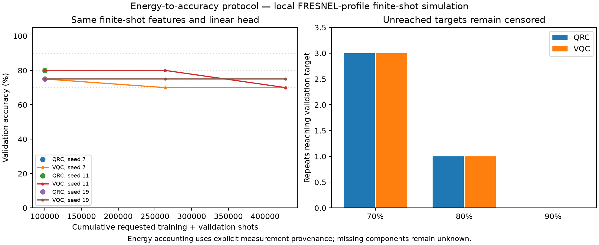

# Finite-shot energy-to-accuracy study: FRESNEL beta profile

Both methods use the same device, input features, pulse encoding, temporal Z/ZZ observables, finite-shot allocation, detector/noise model and classical linear-regression procedure. QRC fixes its pulse offsets. VQC updates them using sampled minibatch SPSA and refits the same linear head.

## Physical profile and hardware path

Target identifier: **FRESNEL**. The account-specific beta generation is unverified. 4 atoms; 4 slots; mixing 5.6549 rad/us; nearest-neighbor interaction/mixing [1.0000003034081866, 0.9999994830721981, 1.0000003034081866]; encoding/mixing 1.000. Slot 356 ns with 72 ns ramps. The comparable-scale regime follows [Kornjača et al., Supplementary II.2](https://arxiv.org/html/2407.02553v1). Device limits, layout size/filling, clock and pulse bounds are validated locally by Pulser.

Layout has 60 traps; pre-calibrated: False. The default custom layout requires provider calibration. Serialized example sequences include the layout and measurement instruction and pass local QPU checks. Account access, live calibration and server-side validation are still required. This run submitted no hardware jobs.

## Paired finite-shot protocol

MNIST [3, 8]; 80 train / 20 validation / 40 official-test images per repeat; seeds [7, 11, 19]. Each method uses 1,000 total shots per image, split across [1, 2, 3, 4] prefix readouts. Both train and validate on sampled bitstrings with SPAM; neither is trained on exact state expectations. PCA and feature scaling fit training data only. The ridge/ordinary linear regression implementation and alpha grid are identical. VQC has at most 8 SPSA steps; no convergence claim. Simulation uses 2 noise trajectories, which are not physical shot multipliers.

Targets are declared in the configuration and selected using validation accuracy only. Test images are evaluated after all target/checkpoint decisions are frozen. Reaching the same validation target does not guarantee equal held-out accuracy; both test scores and their tolerance flag are reported. Unreached targets retain their consumed budget and are explicitly censored.

The shared frozen reservoir is also the zero-update member of the VQC family. If it already meets a target, the minimum VQC budget can equal QRC's. Forcing extra optimization would artificially inflate the VQC energy-to-target. This study tests the energy-efficiency hypothesis and does not assume it.

## Observed held-out accuracy

Models below are selected by minimum validation MSE; they are descriptive fallbacks when a target is unavailable. They are not used to declare an unreachable target reached.

| Seed | QRC validation | QRC test | VQC validation | VQC test | VQC selected step | Classical linear test |
|---|---:|---:|---:|---:|---:|---:|
| 7 | 75.0% | 85.0% | 75.0% | 85.0% | 0 | 87.5% |
| 11 | 80.0% | 82.5% | 80.0% | 82.5% | 0 | 92.5% |
| 19 | 75.0% | 92.5% | 75.0% | 92.5% | 0 | 90.0% |

## Energy needed to reach each validation target

Requested physical-shot budgets include all earlier training, validation and objective evaluations. Unsuccessful optimization attempts are retained. The readout reuses stored features for its alpha grid, so a classical refit does not trigger extra quantum shots.

| Target | Seed | QRC status / training shots | VQC status / training shots | Held-out QRC / VQC |
|---|---:|---|---|---|
| 70% | 7 | reached / 100,000 | reached / 100,000 | 85.0% / 85.0% |
| 70% | 11 | reached / 100,000 | reached / 100,000 | 82.5% / 82.5% |
| 70% | 19 | reached / 100,000 | reached / 100,000 | 92.5% / 92.5% |
| 80% | 7 | unreached / 100,000 | unreached / 428,000 | — / — |
| 80% | 11 | reached / 100,000 | reached / 100,000 | 82.5% / 82.5% |
| 80% | 19 | unreached / 100,000 | unreached / 428,000 | — / — |
| 90% | 7 | unreached / 100,000 | unreached / 428,000 | — / — |
| 90% | 11 | unreached / 100,000 | unreached / 428,000 | — / — |
| 90% | 19 | unreached / 100,000 | unreached / 428,000 | — / — |

## Electrical calibration and scenario boundaries

Calibration status: **unavailable**. FRESNEL-specific power, complete cycle time, attempts/loss factor, setup energy and external classical energy are required for complete calibrated totals. Missing values remain null. A measured full cycle already includes pulse execution and is never charged twice.

The JSON separately retains the earlier paper-power / paper-overhead scenarios and a sensitivity using the [provider's published beta throughput](https://www.scaleway.com/en/docs/quantum-computing/additional-content/pasqal-qpus/), 0.25 shots/s, with the same conditional power envelopes. That nominal 4 s/shot cycle is 200 times the previous 20 ms transferred overhead; it is not a measurement of this booked device. The provider page labels the table Beta while its prose mentions Gamma, so the actual account/device generation must be confirmed. These scenarios do not replace electrical metering, include full classical energy, or infer provider charges.

| Target | Seed | Method | Target status | Calibrated training J | Paper-reference training kWh | Nominal beta rate + historical 2.6 kW: training kWh |
|---|---:|---|---|---:|---:|---:|
| 70% | 7 | qrc | reached | unknown | 12.337 | 288.889 |
| 70% | 7 | vqc | reached | unknown | 12.337 | 288.889 |
| 70% | 11 | qrc | reached | unknown | 12.337 | 288.889 |
| 70% | 11 | vqc | reached | unknown | 12.337 | 288.889 |
| 70% | 19 | qrc | reached | unknown | 12.337 | 288.889 |
| 70% | 19 | vqc | reached | unknown | 12.337 | 288.889 |
| 80% | 7 | qrc | unreached; spent budget | unknown | 12.337 | 288.889 |
| 80% | 7 | vqc | unreached; spent budget | unknown | 52.801 | 1236.444 |
| 80% | 11 | qrc | reached | unknown | 12.337 | 288.889 |
| 80% | 11 | vqc | reached | unknown | 12.337 | 288.889 |
| 80% | 19 | qrc | unreached; spent budget | unknown | 12.337 | 288.889 |
| 80% | 19 | vqc | unreached; spent budget | unknown | 52.801 | 1236.444 |
| 90% | 7 | qrc | unreached; spent budget | unknown | 12.337 | 288.889 |
| 90% | 7 | vqc | unreached; spent budget | unknown | 52.801 | 1236.444 |
| 90% | 11 | qrc | unreached; spent budget | unknown | 12.337 | 288.889 |
| 90% | 11 | vqc | unreached; spent budget | unknown | 52.801 | 1236.444 |
| 90% | 19 | qrc | unreached; spent budget | unknown | 12.337 | 288.889 |
| 90% | 19 | vqc | unreached; spent budget | unknown | 52.801 | 1236.444 |

For unreached targets, the table shows the budget already spent, not an estimate of energy that would eventually reach the target. Both power/rate-transfer columns remain conditional scenarios.

## Limits and reuse

This is a small exploratory sample with three paired repeats by default, not a fully converged VQC study or a replication of the paper's complete resampling analysis. Held-out images can overlap between repeat seeds and with earlier studies. Snapshot noise models and derived pulse scales require validation against live hardware. Accuracy or energy advantage is not presumed.

The learning loop accepts a count-backend adapter; the default is local Pulser simulation. Another Pulser-compatible analog device can use a new pinned target profile. Other hardware requires an appropriate sequence compiler and execution adapter. See [the protocol and calibration guide](../../docs/accuracy-energy-protocol.md).

[Machine-readable results](report.json) · [Configuration](../../configs/accuracy_energy_fresnel_beta.json)
