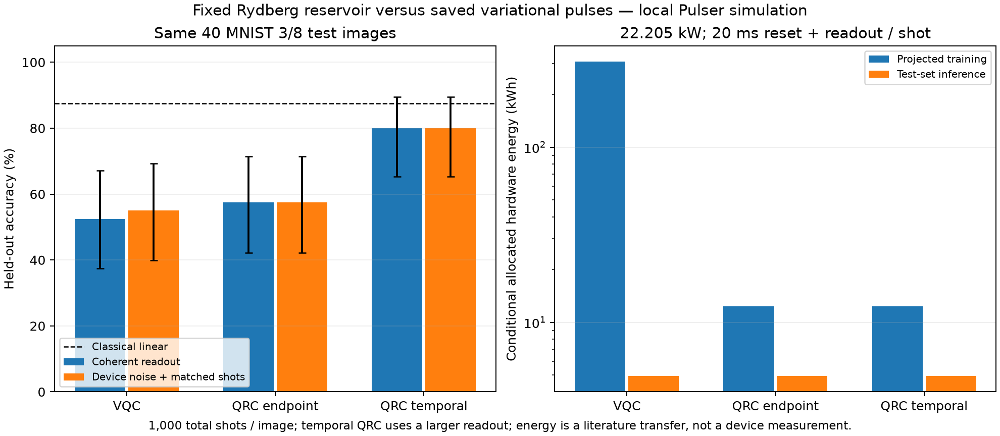

# Pulser quantum reservoir versus variational classifier

Local simulation on the same pinned **Pasqal FRESNEL** public device specification. This implements fixed-control QRC with a trained linear regression readout. No jobs were sent to a QPU.

## Paired protocol

MNIST digits [3, 8]; identical 80 train / 20 validation / 40 test images and archived training-only PCA; 4 atoms; 4 input pulse slots; seed 7. QoolQit compiles the same global amplitude/detuning encoding; Pulser QutipBackendV2 simulates finite bandwidth. QRC fixes the VQC's archived initial pulse offsets, with no reservoir search. Only its classical head is fitted.

The endpoint QRC has the same feature count as VQC and reproduces the existing frozen-pulse ablation. Temporal QRC concatenates Z and ZZ features from separately executed pulse prefixes. Every prefix starts from the ground state, ends with its own physical modulation tail, and requires destructive measurement. It does not obtain several hardware readouts from one shot. Reservoir memory persists between input slots within each prefix; images do not share quantum state.

All heads are fitted on coherent training features and frozen for noisy inference. Their regularization is chosen by validation MSE from the same grid. The VQC uses its saved selected head. Its fixed 12-update SPSA budget has no convergence claim. Noisy reevaluation uses 8 SDK noise trajectories and one sampling seed, with identical device/detector settings. Expectation results precede detector errors; sampled results include SPAM.

The earlier VQC archive used different noise-sampling settings. Its coherent predictions are reproduced exactly here; fresh noisy scores are reported for this common protocol rather than mixed with older scores.

## Held-out task accuracy

Equal total budget: **1,000 shots per image**, allocated across QRC temporal nodes as [250, 250, 250, 250]. The expectation columns describe exact-readout simulations and have no physical finite-shot accuracy assigned.

| Model | Features | Trained quantum parameters | Coherent accuracy | Noisy expectations | Noisy finite-shot accuracy (Wilson 95%) |
|---|---:|---:|---:|---:|---|
| vqc | 10 | 8 | 52.5% | 52.5% | 55.0% (39.8%–69.3%) |
| qrc_endpoint | 10 | 0 | 57.5% | 55.0% | 57.5% (42.2%–71.5%) |
| qrc_temporal | 40 | 0 | 80.0% | 80.0% | 80.0% (65.2%–89.5%) |

Classical PCA + linear regression: **87.5%**. Temporal QRC at 1,000 shots **per node** (4,000 total per image): **77.5%**. That additional condition spends a different hardware-shot budget. Its counts and the smaller-budget condition are correlated because the latter is a random subset of the larger sample.

## Conditional hardware energy and electricity cost

The same versioned [Rydberg energy papers and transfer assumptions](../../docs/literature-energy-cost.md) are used for every model. The main table allocates the full **22.205 kW** reference machine, 10 ms reset + 10 ms readout per physical shot, with the explicitly configured motion/reload counts and the illustrative **0.25 EUR/kWh** tariff. The report also includes the historical vendor-power transfer. These are scenarios, not measured Pasqal consumption or service charges.

| Workload | Shots/image | kWh/image | Test-set kWh | Test-set electricity cost |
|---|---:|---:|---:|---:|
| vqc | 1,000 | 0.123365 | 4.934613 | 1.2337 EUR |
| qrc_endpoint | 1,000 | 0.123365 | 4.934613 | 1.2337 EUR |
| qrc_temporal_equal_total_shots | 1,000 | 0.123364 | 4.934565 | 1.2336 EUR |
| qrc_temporal_equal_shots_per_node | 4,000 | 0.493457 | 19.738261 | 4.9346 EUR |

Every prefix pays its own reset and readout overhead. All Z/ZZ features at one node share the same measured bitstrings; there is no extra shot multiplier for feature count. Source-radiation transfers are recorded separately and never added to whole-machine electrical energy.

## Hypothetical hardware training projection

| Recipe | Circuit-feature evaluations | Hypothetical physical shots | kWh, 22.205 kW scenario |
|---|---:|---:|---:|
| qrc_endpoint | 100 | 100,000 | 12.337 |
| qrc_temporal_equal_total_shots | 400 | 100,000 | 12.336 |
| qrc_temporal_equal_shots_per_node | 400 | 400,000 | 49.346 |
| vqc | 2,500 | 2,500,000 | 308.413 |

Hypothetical finite-shot execution of the recorded training recipes. Training actually used exact coherent expectations on CPU; noisy finite-shot hardware training would change the learned readouts and SPSA trajectory. External classical energy, loading/retries/idle allocation remain unmeasured. A 20 ms reset/readout assumption is transferred, with zero extra motion/reloads.

QRC extracts training/validation features once and caches them for every linear fit. VQC's recorded SPSA recipe repeatedly evaluates its quantum model; the original optimizer, regularization selection and validation checkpoints are included in the count. Training-energy projections do not describe the electricity used by our CPU simulations.

## Interpretation limits

This is an exploratory single-seed check on a small, previously inspected test subset. Wilson intervals are conditional on this run; paired discordance counts and exact McNemar p-values are included in JSON, without a multiple-comparison correction. They do not quantify reservoir-seed variation or all hardware-noise uncertainty. Temporal QRC has a larger linear head than VQC. Neither quantum method is guaranteed to match the other's accuracy. No quantum or energy advantage is established. The preserved eight-atom digital/hybrid research models remain a different architecture and are not supported on this selected global-only interface.

This is an independent adaptation of fixed-reservoir learning, not a reproduction of published QRC accuracies. See [method and papers](../../docs/qrc-vqc-comparison.md). Actual device and end-to-end energy, external classical training/readout energy, retries, loading and provider prices remain unknown.

[Full report and both power scenarios](report.json) · [Control ledger](control_ledger.csv) · [Compiled pulse prefixes](compiled_examples) · [Predictions](splits_predictions.npz)

Reproduce: `.venv-hardware/bin/python -m rydberg_mnist.hardware.qrc --output hardware_results/new_qrc_comparison`.
